# Hi, I'm Leandro Marcucci

Staff Software Engineer in Buenos Aires, Argentina (UTC-3). I have 13 years of experience in backend development, and I specialize in billing and payment systems with Ruby on Rails. At Ring (Amazon), I owned billing APIs that served 1M+ requests per day. Today I work at SportsEngine (NBC Sports) on checkout and pricing.

I also build software with AI agents: I write a spec, an agent writes the code, a second agent reviews it, and I approve the result.

[LinkedIn](https://linkedin.com/in/leanucci) · [Email](mailto:leanucci@gmail.com)

## Featured projects

### [workflows](https://github.com/leanucci/workflows): agent-driven development pipeline

A spec-driven, multi-agent CI/CD pipeline on GitHub Actions. A build agent (Claude Opus) turns a Markdown spec into a pull request. A review agent (Claude Sonnet) does an adversarial review against the spec, and the build agent fixes the findings. Branch protection requires my approval before each merge. The process is in [APPROACH.md](https://github.com/leanucci/portfolio/blob/main/APPROACH.md).

### [pomodoro](https://github.com/leanucci/pomodoro): a web app built by agents

A Pomodoro timer built with Next.js, TypeScript, and Tailwind CSS, and deployed on Vercel. Agents wrote the code from Markdown specs through the workflows pipeline. [Live demo](https://pomodoro-three-xi.vercel.app).

### [bravo](https://github.com/leanucci/bravo) and [wsaa-ruby](https://github.com/leanucci/wsaa-ruby): Ruby gems for AFIP

Ruby gems for electronic invoicing with AFIP, the Argentinian tax agency. bravo gets the invoice authorization code (CAE) from the WSFE web service, and has 40,000+ downloads on [RubyGems](https://rubygems.org/gems/bravo). wsaa-ruby gets the authentication credentials that the AFIP web services need ([RubyGems](https://rubygems.org/gems/wsaa-ruby)).

## Tech stack

## GitHub stats

